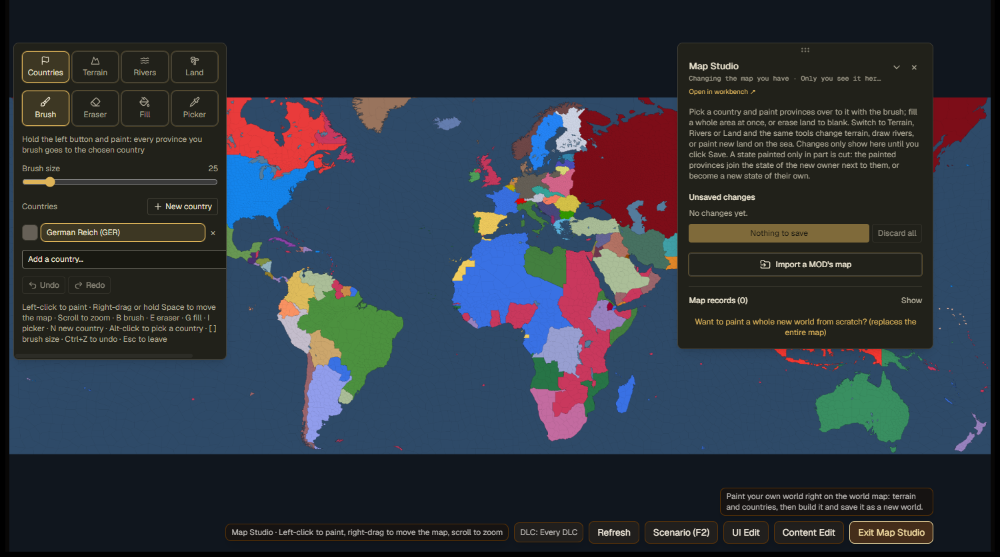
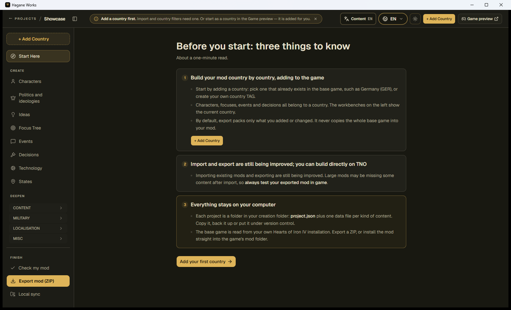
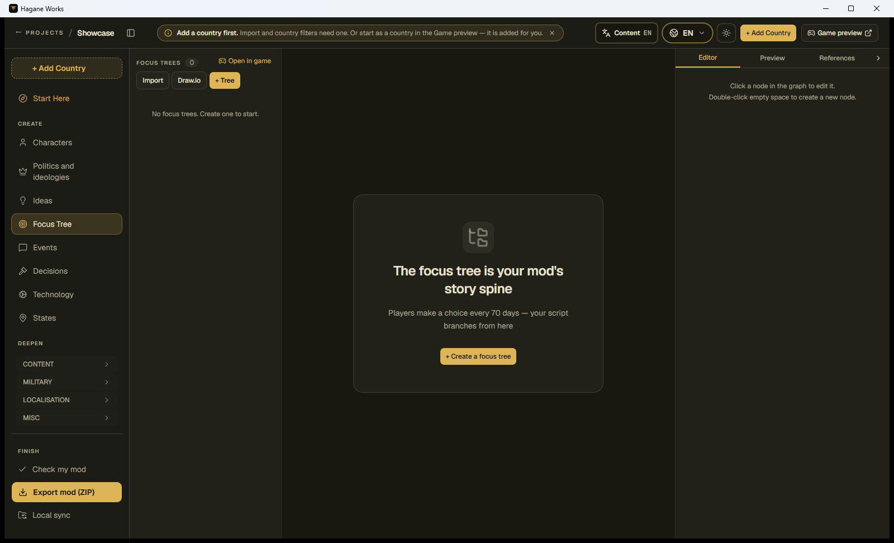

<p align="center">
  
</p>

<h1 align="center">Hagane Works</h1>

<p align="center">
  A local-first visual modding studio for <em>Hearts of Iron IV</em>.
</p>

<p align="center">
  <a href="https://github.com/hagane-works/hagane-studio/releases"></a>
  <a href="LICENSE"></a>
  <a href="https://github.com/hagane-works/hagane-studio/releases"></a>
  
</p>

<p align="center">
  <a href="README.zh.md">简体中文</a> ·
  <a href="https://github.com/hagane-works/hagane-studio/releases">Download</a> ·
  <a href="docs/cli.md">CLI and tool API</a> ·
  <a href="CONTRIBUTING.md">Contributing</a>
</p>



Hagane Works turns HOI4 mod data into focused visual workbenches. Create a project or import an
existing mod, edit its content, inspect it in a reconstruction of the game's interface, and export a
ready-to-test mod without running a hosted service.

> [!IMPORTANT]
> Hagane Works is under active development. Import and export coverage varies by feature and large
> existing mods may contain constructs the editor does not yet preserve. Keep backups and always test
> an exported mod in the game before publishing it.

## Highlights

- Visual editors for characters, countries, ideologies, ideas, focus trees, events, decisions,
  technologies, states, armies and other common content.
- A map studio for countries, terrain, rivers and land, with undo and redo.
- Game-view previews built from the user's own HOI4 installation.
- Import from an existing mod, export to a portable ZIP, or install directly into the game's mod
  directory.
- Local project folders made of readable JSON and original assets; no account, database or hosted
  backend is required.
- English, Simplified Chinese, Russian, German, Spanish, French, Japanese and Korean interfaces.
- Offline HOI4 authoring articles, validation tools and a command-line interface for local automation.

## Download and run

Download a portable ZIP from [GitHub Releases](https://github.com/hagane-works/hagane-studio/releases),
extract the entire archive, and run `HaganeWorks.exe`.

| Package | Use it for |
| --- | --- |
| `windows-x64` | Most Windows 10 and Windows 11 PCs |
| `windows-x86` | 32-bit Windows |
| `windows-arm64` | Windows on ARM devices |

The portable package includes the desktop application, `hw.exe`, quick-start documents, licences,
the embedded interface and the offline knowledge base. Go, Node.js, Python and a database are not
required to run it. The desktop window uses Microsoft Edge WebView2; if WebView2 is unavailable, the
application opens in the default browser.

### First run

1. Install *Hearts of Iron IV* through Steam.
2. Start `HaganeWorks.exe` and select a **creation folder**. Each project will be stored in its own
   subfolder.
3. Create a project or choose **Load existing mod**.
4. Add a country and open a workbench from the sidebar.
5. Use **Check my mod**, then export a ZIP or install the mod into the game directory.

Hagane Works normally finds HOI4 through the Steam library. The installation folder can also be
selected manually. The application does not ship Paradox game files; preview assets are loaded from
the user's own installation.

## What projects contain

```text
<creation folder>/<project>/
  project.json        project metadata, countries, DLC selection and id counters
  data/<table>.json   one file for each kind of editable content
  files/              imported and uploaded pictures and source files
```

Saves are written to a temporary file and renamed into place, preventing an interrupted write from
leaving a partially written project file. Copying a project directory creates an independent backup.

## Screenshots

| Project workspace | Visual workbench |
| --- | --- |
|  |  |

More screenshots are available in [`docs/screenshots`](docs/screenshots).

## Build from source

### Requirements

- Windows 10 or Windows 11
- [Go](https://go.dev/) 1.25 or newer
- [Node.js](https://nodejs.org/) 20 or newer
- Git with submodule support

Clone the repository with its optional CWTools validation rules:

```powershell
git clone --recurse-submodules https://github.com/hagane-works/hagane-studio.git
Set-Location hagane-studio
npm --prefix web ci
npm --prefix web run build
New-Item -ItemType Directory -Force bin | Out-Null
go build -trimpath -ldflags="-H=windowsgui" -o bin/HaganeWorks.exe ./cmd/haganeworks
go build -trimpath -o bin/hw.exe ./cmd/hw
```

Run the result with `./bin/HaganeWorks.exe`. The web interface is embedded in the executable; no
separate frontend server is needed at runtime.

### Development

Run the local backend and Vite development server in separate terminals:

```powershell
go run ./cmd/haganeworks --no-window --port 7330
```

```powershell
$env:HAGANEWORKS_API = "http://127.0.0.1:7330"
npm --prefix web run dev
```

The principal checks are:

```powershell
go test -vet=off ./...
npm --prefix web run typecheck
npm --prefix web run lint
npm --prefix web test -- --run
npm --prefix web run build
```

Create Windows x86, x64 and ARM64 portable packages with:

```powershell
./tools/release-windows.ps1 -Version v0.1.0
```

Pushing a `v*` tag runs the same checks and publishes the archives through GitHub Actions.

## Command-line automation

`hw.exe` exposes the editor's tools to local scripts and other programs, including offline knowledge
search. See [the CLI guide](docs/cli.md) for commands, JSON input, exit codes and the local API security
model.

## Contributing and security

Bug reports and focused pull requests are welcome. Read [CONTRIBUTING.md](CONTRIBUTING.md) before
submitting a change. Please report vulnerabilities privately as described in
[SECURITY.md](SECURITY.md), not in a public issue.

## License and attribution

The project source, documentation, original artwork and original knowledge-base articles are licensed
under [GNU GPL v3.0 only](LICENSE). Distributed binaries and modified versions must be accompanied by
their corresponding GPL-licensed source.

Components under `third_party/` and files carrying their own licence remain under those licences. The
software and font notices bundled with the application are listed in
[THIRD_PARTY_NOTICES.md](THIRD_PARTY_NOTICES.md). External sources cited by knowledge-base articles are
references and are not relicensed by this project.

Hagane Works is a fan-made project. It is not affiliated with, endorsed by or sponsored by Paradox
Interactive. *Hearts of Iron IV* and related marks belong to their respective owners.
