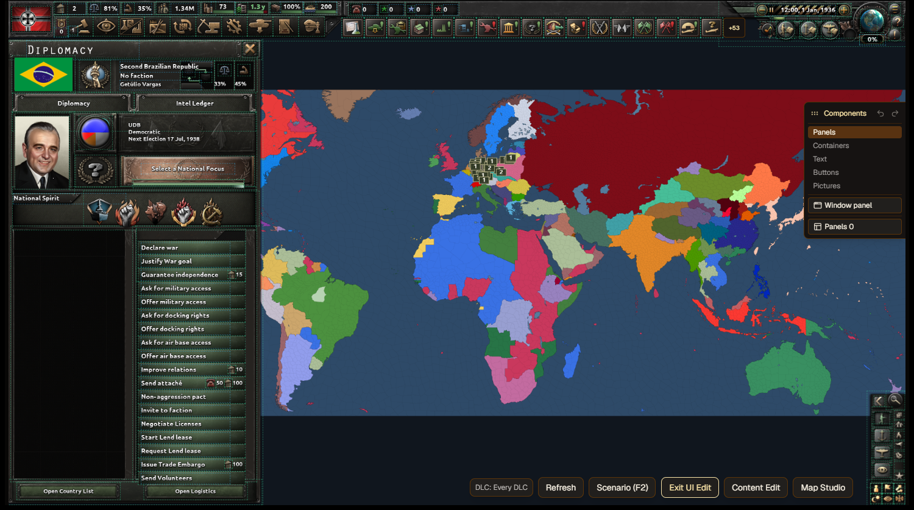

<p align="center">
  
</p>

<h1 align="center">钢之工坊</h1>

<p align="center">
  本地运行的《钢铁雄心 IV》可视化 Mod 制作工具。
</p>

<p align="center">
  <a href="https://github.com/hagane-works/hagane-studio/actions/workflows/release.yml"></a>
  <a href="LICENSE"></a>
  
</p>

<p align="center">
  <a href="README.md">English</a> ·
  <a href="https://github.com/hagane-works/hagane-studio/releases">下载</a> ·
  <a href="docs/cli.md">命令行与工具接口</a> ·
  <a href="CONTRIBUTING.md">参与贡献</a>
</p>


钢之工坊将 HOI4 Mod 数据整理成可视化工作台。你可以新建项目或导入已有 Mod，编辑其中的内容，
在重建的游戏界面中检查效果，再导出可供测试的 Mod。整个过程在本机完成，不依赖在线服务。

> [!IMPORTANT]
> 钢之工坊仍在积极开发。不同功能的导入、导出覆盖程度并不完全相同，大型 Mod 也可能包含编辑器尚不能
> 完整保留的特殊写法。请保留备份，并在发布前进入游戏测试导出结果。

## 主要功能

- 可视化编辑人物、国家、意识形态、民族精神、国策树、事件、决议、科技、地块、军队等常用内容。
- 在地图工作室中编辑国家、地形、河流和陆地，支持撤销与重做。
- 从用户自己的 HOI4 安装目录读取素材，并在重建的游戏界面中预览。
- 导入已有 Mod，导出便携 ZIP，或直接安装到游戏的 Mod 目录。
- 项目由可读的 JSON 和原始素材组成；不需要账号、数据库或在线后端。
- 提供中文、英文、俄文、德文、西班牙文、法文、日文和韩文界面。
- 内置离线 HOI4 制作文章、校验工具，以及用于本机自动化的命令行接口。

## 下载与运行

从 [GitHub Releases](https://github.com/hagane-works/hagane-studio/releases) 下载便携 ZIP，完整解压后
运行 `HaganeWorks.exe`。

| 发布包 | 适用设备 |
| --- | --- |
| `windows-x64` | 绝大多数 Windows 10 和 Windows 11 电脑 |
| `windows-x86` | 32 位 Windows |
| `windows-arm64` | Windows on ARM 设备 |

便携包中包含桌面程序、`hw.exe`、快速说明、许可证、内置界面和离线知识库。运行时不需要安装 Go、
Node.js、Python 或数据库。桌面窗口使用 Microsoft Edge WebView2；如果系统没有 WebView2，程序会在
默认浏览器中打开。

### 第一次使用

1. 通过 Steam 安装《钢铁雄心 IV》。
2. 启动 `HaganeWorks.exe`，选择一个**创作目录**；每个项目会保存在单独的子目录中。
3. 新建项目，或选择**载入现有 Mod**。
4. 添加一个国家，然后从侧边栏进入需要的工作台。
5. 使用**检查我的 Mod**，再导出 ZIP 或直接安装到游戏目录。

程序通常可以从 Steam 库自动找到 HOI4，也支持手动选择安装目录。仓库和发布包不包含 Paradox 的游戏
文件；预览所需素材来自用户自己的游戏安装。

## 项目文件

```text
<创作目录>/<项目>/
  project.json        项目元数据、国家、DLC 选择和编号计数器
  data/<表名>.json    每类可编辑内容对应一个文件
  files/              导入和上传的图片及源文件
```

保存时会先写入临时文件，再将其改名到目标位置，避免意外中断留下不完整的项目文件。直接复制项目目录
即可建立独立备份。

## 界面预览

| 可视化工作台 | 游戏界面预览 |
| --- | --- |
|  |  |

更多图片位于 [`docs/screenshots`](docs/screenshots)。

## 从源码构建

### 环境要求

- Windows 10 或 Windows 11
- [Go](https://go.dev/) 1.25 或更高版本
- [Node.js](https://nodejs.org/) 20 或更高版本
- 支持子模块的 Git

克隆仓库及可选的 CWTools 校验规则：

```powershell
git clone --recurse-submodules https://github.com/hagane-works/hagane-studio.git
Set-Location hagane-studio
npm --prefix web ci
npm --prefix web run build
New-Item -ItemType Directory -Force bin | Out-Null
go build -trimpath -ldflags="-H=windowsgui" -o bin/HaganeWorks.exe ./cmd/haganeworks
go build -trimpath -o bin/hw.exe ./cmd/hw
```

构建完成后运行 `./bin/HaganeWorks.exe`。界面已经嵌入可执行文件，运行时不需要单独启动前端服务。

### 开发

在两个终端中分别启动本机后端和 Vite 开发服务器：

```powershell
go run ./cmd/haganeworks --no-window --port 7330
```

```powershell
$env:HAGANEWORKS_API = "http://127.0.0.1:7330"
npm --prefix web run dev
```

主要检查命令：

```powershell
go test -vet=off ./...
npm --prefix web run typecheck
npm --prefix web run lint
npm --prefix web test -- --run
npm --prefix web run build
```

生成 Windows x86、x64 和 ARM64 便携包：

```powershell
./tools/release-windows.ps1 -Version v0.1.0
```

推送 `v*` 标签后，GitHub Actions 会执行相同检查并发布生成的压缩包。

## 命令行自动化

`hw.exe` 可以把编辑器工具和离线知识检索提供给本机脚本及其他程序。命令、JSON 输入、退出码和接口
安全机制见[命令行说明](docs/cli.md)。

## 参与贡献与安全问题

欢迎提交问题报告和范围清楚的 Pull Request。修改前请先阅读 [CONTRIBUTING.md](CONTRIBUTING.md)。
安全漏洞请按照 [SECURITY.md](SECURITY.md) 私下报告，不要发布到公开 Issue。

## 许可证与权利说明

项目源代码、文档、原创美术素材和原创知识库文章采用 [GNU GPL v3.0 only](LICENSE) 发布。分发二进制
程序或修改版时，必须同时提供对应的 GPL 源代码。

`third_party/` 中的组件以及带有独立许可证的文件继续采用各自的许可证。随程序分发的软件和字体声明见
[THIRD_PARTY_NOTICES.md](THIRD_PARTY_NOTICES.md)。知识库文章引用的外部资料仅作为参考，不因此改用
本项目的许可证。

钢之工坊是玩家自制项目，与 Paradox Interactive 无隶属、授权或赞助关系。《钢铁雄心 IV》及相关标识
的权利归各自权利人所有。
